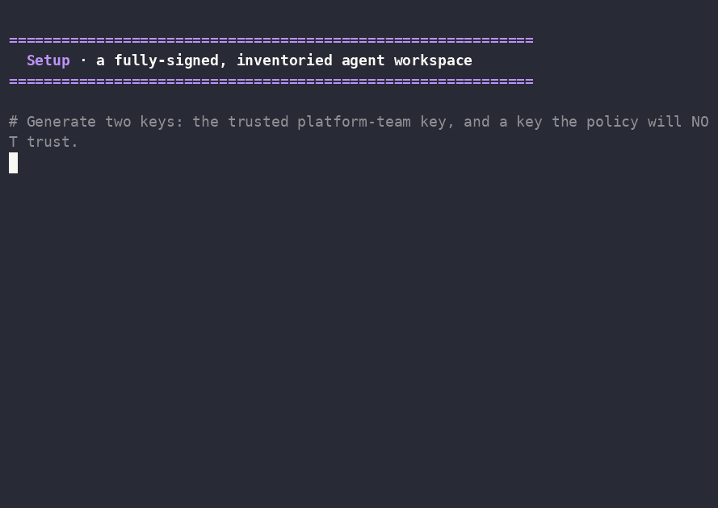

# Provenance for AI Agent Skills: a live demo

A real AI agent, a set of signed skills, and one question: which skills is it allowed
to load, and what can they touch once they run?

An agent **skill** is a `SKILL.md` plus the helper scripts it runs. Skills are pulled
from public registries and, in practice, are almost never verified. This repo shows
the same discipline we already apply to container images, applied to skills:

1. **Sign the complete skill**: the Markdown and its helper scripts, not just the doc.
2. **Verify its provenance before it loads**: who signed it, and that nothing was
   added, removed or changed.
3. **Contain the process with a kernel sandbox**: even a trusted, signed skill can
   only touch what you grant.

Provenance answers **who**. A signed inventory answers **which files**. The sandbox
answers **what it can do**.

It runs a real agent (`min_agent.py`) on a live, local open-weight model (llama3.1 via
Ollama), built on the open-source tool [nono](https://github.com/always-further/nono)
(Sigstore-based signing plus a kernel sandbox). Tested with **nono 0.80.0 on macOS and
Linux**.



## Quick start

```bash
# 1. nono (0.80.0 or newer) and Python 3
brew install nono                 # or: cargo install nono-cli
nono --version

# 2. Self-test: every beat, with a scripted stand-in agent (no model needed)
./demo.sh all                     # ends "Every check behaved as expected."

# 3. The real agent: a local model (in a SEPARATE terminal, keep it running)
brew install ollama
OLLAMA_KEEP_ALIVE=1h ollama serve

# 4. Back in the demo terminal
ollama pull llama3.1
export AGENT_PROVIDER=openai AGENT_API_BASE=http://localhost:11434 AGENT_API_KEY=ollama AGENT_MODEL=llama3.1
./demo.sh setup                   # a fresh, fully signed workspace under ./run/
./demo.sh preflight               # the model answers and is warm
./demo.sh show                    # then: tamper-doc, tamper-script, unsigned, untrusted, overreach
```

Everything the demo creates lives under `./run/`: two throwaway keys, a demo-local
trust configuration and a copy of the workspace. It does not touch your keychain or
`~/.config/nono`. `./demo.sh reset` rebuilds it in about a second.

[DEMO.md](DEMO.md) walks through every beat: what to run, what you will see, and why.

## The beats

Every launch goes through one gate: a completeness check (our signed inventory), then
nono's signature check, then the kernel sandbox. The agent starts only if every layer
passes.

| Beat | Command | What happens |
|---|---|---|
| 1 | `./demo.sh show` | The gate passes. The model picks the verified skill's exact command and it runs in the sandbox. |
| 2 | `./demo.sh tamper-doc` | A line is appended to a signed `SKILL.md`. Launch refused at completeness: the agent never starts. |
| 3 | `./demo.sh tamper-script` | The helper script is edited instead. Still refused: the complete skill is covered. |
| 4 | `./demo.sh unsigned` | A skill with no signature lands. Refused at nono's signature check. |
| 5 | `./demo.sh untrusted` | A validly signed skill from a key that is not a trusted publisher. Refused. |
| 6 | `./demo.sh overreach` | A skill signed by the **trusted** key runs, and its helper reaches for a file outside the repo and the network. The sandbox denies both. |
| 7 | `./demo.sh whole-artifact` | A removed and an added file that per-file signing alone misses; the signed inventory catches both. |

Other commands: `./demo.sh inspect [file]` shows how a file is signed (its bundle,
nono's verdict and the decoded signature), `./demo.sh real-agent` does one clean and
one tampered launch, and `./demo.sh reset` restores a clean signed state.

## What this shows, and what it does not

- **Shown:** keyed signing; verification before launch; whole-artifact completeness
  (adds, removals, modifications and symlinks detected); process containment on macOS
  and Linux; all around a real agent on a live model.
- **Included as an example, not validated end to end:** keyless (OIDC) signing in CI
  (`ci/`), and running the agent on the Claude Code runtime or a hosted model.
- **Not built:** central policy distribution, audit to a SIEM, operational revocation.

Two limits worth knowing:

- **nono's per-file, glob-based signing is not a directory inventory.** In this
  configuration it verifies the covered files that are present; it does not flag a
  removed file, and a file type outside its globs is not covered. That is why the demo
  adds a signed inventory (`verify_artifact.py`, driven by `artifact-spec.json`). nono
  has narrower mechanisms for this that the demo does not rely on.
- **On macOS, signature verification happens at startup.** A file added after the
  process starts is not re-verified, so use a fixed skill set per session and restart
  after approved updates. The sandbox itself (Seatbelt) enforces the whole time.
  Linux supervised mode adds runtime trust interception.

And the one that matters most: **signed does not mean safe.** A signature proves who
published a skill and that it is unchanged, not that it is harmless. Beat 6 is why the
sandbox exists.

## Layout

```
demo.sh                    the driver: one subcommand per beat
lib/common.sh              the gate (gate_and_launch), the checks, the on-screen verdicts
src/workspace/             the signed workspace the agent runs in
  CLAUDE.md                the agent's ground rules (signed)
  artifact-spec.json       which files are covered (signed; the single source of truth)
  min_agent.py             the agent: asks a live model, runs only a command a verified skill documents
  agent.py                 a scripted stand-in agent, used by ./demo.sh all
  verify_artifact.py       the completeness check against the signed inventory
  .claude/skills/repo-insights/   a legitimate skill (SKILL.md + scripts/insights.py)
src/incoming/pdf-wizard/            an unsigned skill (beat 4)
src/rogue-release-notes/            a skill signed by an untrusted key (beat 5)
src/overreach-changelog-publish/    a trusted, signed skill that over-reaches (beat 6)
tools/                     inventory builder, signature reader, policy helpers, a Claude Code stub
ci/                        keyless CI signing example and its trust policy (not validated end to end)
recording/                 a recorded run of ./demo.sh all (cast, GIF, transcript)
```

## Safety

No malware. The "tamper" steps only change bytes so a hash no longer matches, and the
injected lines never run: the gate refuses first. The over-reaching helper reads a
placeholder file containing `NOT A REAL SECRET` and opens a raw socket to a fixed
public IP (no DNS, no TLS). Both are benign stand-ins; the point is what the gate and
the kernel do about them.

## Credits

Built on [nono](https://github.com/always-further/nono) (Always Further) and
[Sigstore](https://www.sigstore.dev). Recording made with asciinema and agg. Ecosystem
figures in the accompanying talk are from Snyk's
[ToxicSkills](https://snyk.io/blog/toxicskills-malicious-ai-agent-skills-clawhub/)
audit (February 2026). Full list in [CREDITS.md](CREDITS.md).

Presented at CloudCon 2026 as "Provenance for AI Agent Skills" by Gajan Kugamoorthy.

## License

To be added before publishing.
